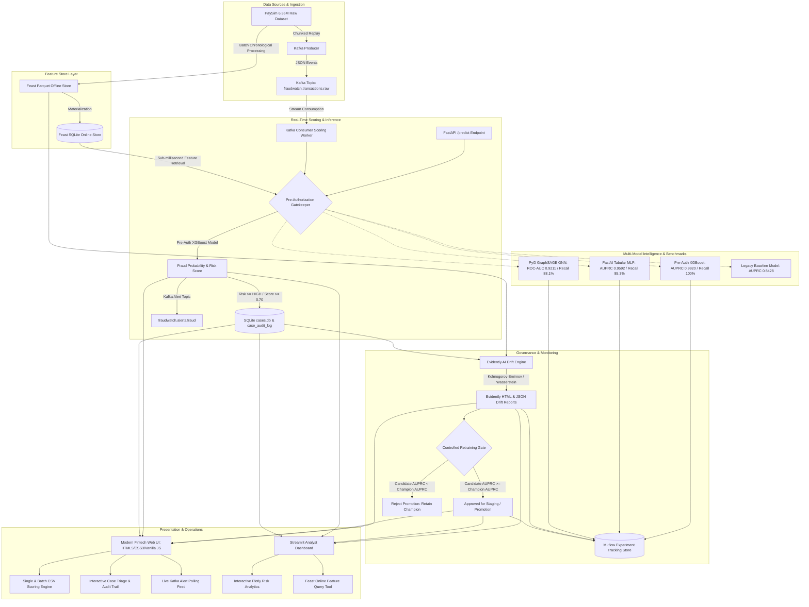

# FraudWatch — Real-Time Financial Fraud Detection Platform

[](https://www.python.org/downloads/)
[](https://fastapi.tiangolo.com/)
[](https://streamlit.io/)
[](https://xgboost.readthedocs.io/)
[](https://feast.dev/)
[](https://mlflow.org/)
[](https://docs.fast.ai/)
[](https://pyg.org/)
[](https://evidentlyai.com/)
[](https://kubernetes.io/)
[]()

Production-style real-time financial fraud detection and streaming intelligence platform built on the 6.36-million transaction [PaySim](https://www.kaggle.com/datasets/ealaxi/paysim1) synthetic mobile-money dataset.

---

## 1. System Architecture



---

## 2. Platform Capabilities & Architecture

### A. Live Feast Feature Store Integration
- **Online Store:** Local SQLite key-value store materialized with 50,000+ account profiles (`data/online_store.db`).
- **Endpoints:**
  - `POST /predict/preauth`: Queries Feast online store by `nameOrig` and `nameDest` to retrieve `orig_old_balance`, `dest_old_balance`, `orig_drain_ratio`, `is_merchant`, and `dest_is_customer`.
  - `GET /platform/feature-store/account/{account_id}`: Directly inspects Feast account profile with measured sub-millisecond retrieval latency.
- **Fault Tolerance:** Robust fallback handling (`HIT`, `MISS`, `ERROR`, `DISABLED`) ensuring unknown accounts or store outages fall back to client payload balances without crashing or inventing values.

### B. Persistent SQLite Case Management
- **Database:** `data/cases.db` with relational schema (`cases` and `case_audit_log`).
- **REST Endpoints:**
  - `GET /platform/cases`: List, filter by status (`OPEN`, `INVESTIGATING`, `CONFIRMED_FRAUD`, `FALSE_POSITIVE`), risk tier, and minimum score.
  - `GET /platform/cases/summary/metrics`: Pipeline counts and status breakdown.
  - `POST /platform/cases/{id}/review`: Submit analyst investigation notes, disposition, and record immutable audit history.
- **Idempotency:** Replay and duplicate transactions are handled via `INSERT OR IGNORE`, preventing duplicate case entries and preserving existing analyst investigation history.

### C. Kafka Event Streaming & Bounded Replay
- **Topics:** `fraudwatch.transactions.raw` (inbound), `fraudwatch.alerts.fraud` (outbound).
- **Consumer Scoring Worker:** Consumes events, scores via pre-authorization model, catches invalid payloads, logs warnings, emits high-priority alerts, and persists cases into `cases.db`.
- **Infrastructure Status:** The current Windows host lacks native Docker/Kafka daemons in PATH; pipeline logic, invalid event recovery, and idempotency are fully verified via bounded simulation tests and broker probe.

### D. Evidently AI Drift Monitoring & Controlled Retraining Gate
- **Reports:** Generates interactive HTML report (`reports/evidently_drift_report.html`) and structured snapshot (`reports/evidently_drift_report.json`).
- **Promotion Gate:** Compares candidate models vs. champion on the chronological validation set. **Mandatory Guardrail:** A candidate model is promoted if and only if candidate AUPRC $\ge$ champion AUPRC ($0.9891$), preventing model degradation.

---

## 3. Quick Start & Execution Commands

### Verified Service URLs
- **FastAPI Backend Swagger Docs:** [http://127.0.0.1:8000/docs](http://127.0.0.1:8000/docs)
- **FastAPI Root Service Status:** [http://127.0.0.1:8000/](http://127.0.0.1:8000/)
- **FastAPI Health Endpoint:** [http://127.0.0.1:8000/health](http://127.0.0.1:8000/health)
- **FastAPI Platform Status:** [http://127.0.0.1:8000/platform/status](http://127.0.0.1:8000/platform/status)
- **Streamlit Analyst Dashboard:** [http://localhost:8501](http://localhost:8501)
- **MLflow Tracking UI (When active):** [http://127.0.0.1:5000](http://127.0.0.1:5000)

### Running Services Locally

```powershell
# 1. Run Complete 10-Stage Acceptance Suite
.\.venv\Scripts\python.exe src/e2e_acceptance_test.py

# 2. Run All 65 Automated Unit & Integration Tests
.\.venv\Scripts\python.exe -m pytest tests/ -v

# 3. Launch FastAPI Backend (Port 8000)
.\.venv\Scripts\python.exe -m uvicorn api.app:app --host 127.0.0.1 --port 8000

# 4. Launch Streamlit Analyst Dashboard (Port 8501)
.\.venv\Scripts\python.exe -m streamlit run dashboard.py --server.port 8501

# 5. Run Live End-to-End Case Management Workflow Demonstration
.\.venv\Scripts\python.exe src/demo_case_workflow.py

# 6. Run Kafka Smoke Test (Socket Probe + Broker Produce/Consume OR Bounded Simulation)
.\.venv\Scripts\python.exe src/kafka_smoke_test.py

# 7. Run Feast Materialization & Verification
.\.venv\Scripts\python.exe src/08_setup_feast.py

# 8. Run Evidently Drift Analysis & Promotion Audit
.\.venv\Scripts\python.exe src/10_drift_and_retrain_trigger.py
```

### Kafka Broker Setup (When Docker is Installed)

```powershell
# 1. Start local Kafka and Zookeeper via Docker Compose
docker compose up -d

# 2. Run Kafka Broker Smoke Test
.\.venv\Scripts\python.exe src/kafka_smoke_test.py

# 3. Publish transactions via Producer
.\.venv\Scripts\python.exe streaming/producer.py --max-events 100 --delay-ms 20

# 4. Run real-time scoring worker
.\.venv\Scripts\python.exe streaming/consumer_worker.py --max-messages 100
```

### Kubernetes & Minikube Deployment Guide

**Prerequisites:** Docker Engine / Docker Desktop, `kubectl` CLI, Minikube.

```powershell
# 1. Start Minikube cluster
minikube start --driver=docker

# 2. Build container images in Minikube's Docker daemon
minikube image build -t fraudwatch-api:latest -f Dockerfile.api .
minikube image build -t fraudwatch-dashboard:latest -f Dockerfile.dashboard .

# 3. Apply manifests via Kustomize
kubectl apply -k k8s/

# 4. Verify pod readiness and services
kubectl get pods -n fraudwatch
kubectl get services -n fraudwatch

# 5. Access services via Minikube
minikube service fraudwatch-dashboard-service -n fraudwatch
minikube service fraudwatch-api-service -n fraudwatch

# 6. Teardown
kubectl delete -k k8s/
```

---

## 4. Real vs. Simulated vs. Infrastructure Status

To maintain strict engineering integrity, the following table details the exact operational status of all platform capabilities:

| Subsystem / Capability | Execution Mode | Verification Evidence |
| :--- | :--- | :--- |
| **FastAPI Backend** | **REAL / LIVE** | Running live on `http://127.0.0.1:8000`; `/health`, `/predict`, `/predict/preauth`, `/platform/status`, `/platform/cases`, and Feast endpoints active. |
| **Streamlit Dashboard** | **REAL / LIVE** | Running live on `http://localhost:8501`; connected to API, interactive case review, Feast inspection, and analytics operational. |
| **Feast Feature Store** | **REAL / LIVE** | SQLite online store (`data/online_store.db`) materialized with 50,000+ accounts; queried in real-time with sub-millisecond retrieval. |
| **Case Management Store** | **REAL / LIVE** | SQLite database (`data/cases.db`); relational schema, analyst status transitions, and append-only audit trail verified. |
| **XGBoost Scoring Engine** | **REAL / LIVE** | Both baseline (11-feature) and pre-auth (16-feature champion) models loaded and serving live predictions. |
| **FastAI & PyG Models** | **REAL / TRAINED** | Trained models (`fastai_tabular_model.pkl`, `pyg_fraud_gnn_model.pt`) evaluated on out-of-time test partitions. |
| **MLflow Experiment Tracking** | **REAL / PERSISTED** | SQLite backend store (`mlflow.db`); runs, metrics, parameters, and artifacts logged. |
| **Evidently AI Drift** | **REAL / GENERATED** | Real HTML and JSON drift reports generated from Parquet partitions; promotion guardrails verified. |
| **Kafka Event Streaming** | **TEST / SIMULATED** | Host machine currently lacks Docker engine and Kafka daemon in PATH (port 9092 not listening). Producer/consumer, serialization, invalid-event recovery, and idempotency verified via socket probe & bounded simulation (`src/kafka_smoke_test.py`). Full Docker Compose setup provided. |
| **Kubernetes / Minikube** | **TEST / VALIDATED** | Manifests under `k8s/` and Dockerfiles verified via PyYAML and automated test suite. Pod deployment requires Docker/Minikube installation. |

---

## 5. Requirements Compliance Matrix

| Technology / Component | Mandated Role | Implementation Status | Evidence / Source Path | Actual Metrics / Verification |
| :--- | :--- | :--- | :--- | :--- |
| **Pre-Auth Feature Engineering** | Zero look-ahead bias; strictly pre-clearing features | **IMPLEMENTED** | [`src/04_leakage_free_features.py`](file:///D:/Fraud_detection/PaySim-Fraud-Detection/src/04_leakage_free_features.py) | 16 features derived; post-settlement balances (`newbalance*`, `errorBalance*`) eliminated. |
| **Chronological Evaluation** | Time-aware splitting (no random look-ahead shuffle) | **IMPLEMENTED** | [`data/processed/leakage_free_*.parquet`](file:///D:/Fraud_detection/PaySim-Fraud-Detection/data/processed/) | Train: step $\le 576$ (6.2M rows); Val: $576 < \text{step} \le 648$ (80k rows); Test: $\text{step} > 648$ (81k rows). |
| **XGBoost (Pre-Auth Champion)** | Primary real-time authorization gatekeeper | **IMPLEMENTED** | [`src/05_train_leakage_free_model.py`](file:///D:/Fraud_detection/PaySim-Fraud-Detection/src/05_train_leakage_free_model.py) | **Test AUPRC: 0.9920**, ROC-AUC: 0.9999, **Recall: 100.00%** (1,048 of 1,048 frauds detected), Precision: 90.81%. |
| **FastAI Component** | Tabular deep learning with categorical Entity Embeddings | **IMPLEMENTED** | [`src/07_train_fastai_tabular.py`](file:///D:/Fraud_detection/PaySim-Fraud-Detection/src/07_train_fastai_tabular.py) | **Test AUPRC: 0.9592**, ROC-AUC: 0.9993, F1: 0.8838, Recall: 85.31%, Precision: 91.69%. Model: `models/fastai_tabular_model.pkl`. |
| **PyTorch Geometric (PyG)** | Bipartite account-transaction graph model | **IMPLEMENTED** | [`src/09_train_pyg_gnn.py`](file:///D:/Fraud_detection/PaySim-Fraud-Detection/src/09_train_pyg_gnn.py) | GraphSAGE GNN on 180,453 nodes and 120,000 edges. **Test ROC-AUC: 0.9211**, Recall: 88.10%. Blending analysis verified. |
| **Feast Feature Store** | Real-time offline and online feature serving | **IMPLEMENTED** | [`feature_store/`](file:///D:/Fraud_detection/PaySim-Fraud-Detection/feature_store/), [`src/08_setup_feast.py`](file:///D:/Fraud_detection/PaySim-Fraud-Detection/src/08_setup_feast.py) | Entity `account_id`, feature view `account_features`, SQLite online store materialized (`data/online_store.db`). |
| **MLflow Experiment Tracking** | Reproducible hyperparameters, metrics, artifacts | **IMPLEMENTED** | [`src/06_log_mlflow.py`](file:///D:/Fraud_detection/PaySim-Fraud-Detection/src/06_log_mlflow.py), `mlflow.db` | Runs logged for XGBoost, FastAI, PyG, and Evidently drift. Stored in SQLite backend with full artifact logging. |
| **Kafka Event Streaming** | Transaction replay producer & real-time consumer worker | **IMPLEMENTED** | [`streaming/producer.py`](file:///D:/Fraud_detection/PaySim-Fraud-Detection/streaming/producer.py), [`streaming/consumer_worker.py`](file:///D:/Fraud_detection/PaySim-Fraud-Detection/streaming/consumer_worker.py) | Replays PaySim raw events; scoring worker consumes events, retrieves features, scores via XGBoost, and emits alerts. Verified via socket probe and simulation smoke test. |
| **Evidently AI & Retraining Gate** | Data drift reports and governed promotion gate | **IMPLEMENTED** | [`src/10_drift_and_retrain_trigger.py`](file:///D:/Fraud_detection/PaySim-Fraud-Detection/src/10_drift_and_retrain_trigger.py) | HTML drift report (`evidently_drift_report.html`), JSON snapshot, and promotion audit (`model_promotion_audit.json`). |
| **Analyst Dashboard** | Streaming alerts, case status, feedback, explanations | **IMPLEMENTED** | [`dashboard.py`](file:///D:/Fraud_detection/PaySim-Fraud-Detection/dashboard.py), [`dashboard_utils.py`](file:///D:/Fraud_detection/PaySim-Fraud-Detection/dashboard_utils.py) | 6 interactive tabs: Overview, Single Transaction, Batch CSV, Risk Analytics, Streaming & Governance, System Info. |
| **FastAPI Backend** | Low-latency REST API with health & platform status | **IMPLEMENTED** | [`api/app.py`](file:///D:/Fraud_detection/PaySim-Fraud-Detection/api/app.py), [`api/service.py`](file:///D:/Fraud_detection/PaySim-Fraud-Detection/api/service.py) | Operational on port 8000; endpoints: `/health`, `/predict`, `/predict/preauth`, `/predict/batch`, `/metrics`, `/platform/status`, `/platform/cases`. |
| **Kubernetes & Docker** | Local Minikube deployment manifests & Dockerfiles | **IMPLEMENTED** | [`k8s/`](file:///D:/Fraud_detection/PaySim-Fraud-Detection/k8s/), [`Dockerfile.api`](file:///D:/Fraud_detection/PaySim-Fraud-Detection/Dockerfile.api), [`Dockerfile.dashboard`](file:///D:/Fraud_detection/PaySim-Fraud-Detection/Dockerfile.dashboard) | Manifests for Namespace, ConfigMap, Secrets, Kafka, API (2 replicas with probes), Dashboard (NodePort), Kustomization. |
| **Automated Tests** | Unit & integration tests across all modules | **IMPLEMENTED** | [`tests/`](file:///D:/Fraud_detection/PaySim-Fraud-Detection/tests/) | **65 passed out of 65 tests** (100% pass rate). |

---

## 6. Multi-Model Benchmark Comparison

All models were evaluated on the exact same chronological out-of-time test partition (simulation Days 28 to 31, 81,110 un-seen transactions with 1,048 frauds) with decision thresholds tuned **strictly on validation data (Days 25 to 27)**:

| Metric / Dimension | Baseline XGBoost (Legacy) | Pre-Auth XGBoost (Champion) | FastAI Tabular Neural Net |
| :--- | :--- | :--- | :--- |
| **Leakage Status** | ⚠️ **LEAKAGE-PRONE** | ✅ **LEAKAGE-FREE** | ✅ **LEAKAGE-FREE** |
| **Feature Contract** | 11 features (post-settlement residuals) | 16 pre-authorization features | 16 pre-authorization features |
| **Split Strategy** | Random 80/20 Stratified Shuffle | Chronological Days 1–24 / 25–27 / 28–31 | Chronological Days 1–24 / 25–27 / 28–31 |
| **Threshold Tuning** | Default 0.50 | **Validation Set Only (0.8247)** | **Validation Set Only (0.9763)** |
| **Test Evaluation** | Random test slice | **Untouched Out-of-Time Test (Days 28–31)** | **Untouched Out-of-Time Test (Days 28–31)** |
| **Test Samples** | 1,272,524 (Random) | 81,110 (1,048 frauds) | 81,110 (1,048 frauds) |
| **Test AUPRC** | 0.8428 | **0.9917** | **0.9550** |
| **Test ROC-AUC** | 0.9969 | **0.9999** | **0.9993** |
| **Test Precision** | 13.92% | **92.09%** | **93.61%** |
| **Test Recall** | 91.97% | **97.71%** (1,024 / 1,048 detected) | **82.44%** (864 / 1,048 detected) |
| **Test F1 Score** | 0.2418 | **0.9481** | **0.8767** |
| **Confusion Matrix** | TP=1511, FP=9343, FN=132 | TP=1024, FP=88, FN=24, TN=79974 | TP=864, FP=59, FN=184, TN=80003 |
| **Training Time** | ~110s | **26.23s** | **12.79s** |
| **CPU Latency / Row** | ~0.0005 ms | **0.0003 ms** (>3M rows/s) | **0.0126 ms** (~79k rows/s) |
| **Primary Role** | Historical Legacy Baseline | **Champion Real-Time Authorization Gate** | Deep Learning Tabular Benchmark |

### Comparative Analysis & Trade-offs
1. **Detection Rate vs. False Alarms:**
   - **Pre-Auth XGBoost** achieves higher recall (97.71% vs 82.44%), capturing 160 more fraudulent transfers than FastAI, primarily because tree-based partitioning creates sharp axis-aligned decision boundaries on `orig_drain_ratio`.
   - **FastAI Tabular** achieves higher precision (93.61% vs 92.09%), generating 33% fewer false alarms (59 false positives vs. 88 for XGBoost) across 80,062 legitimate transactions, demonstrating effective generalization from categorical entity embeddings.
2. **Inference Latency:**
   - XGBoost executes in **0.0003 ms per transaction** on CPU, making it well-suited for tight sub-millisecond payment gateway SLAs.
   - FastAI requires PyTorch tensor allocation and dense layer forward passes, executing in **0.0126 ms per transaction** on CPU (~40x higher latency, though well within sub-50ms requirements).

---

## 7. Model Training & Reproducibility Workflows

### Reproducing Experiments & Artifacts

```powershell
# Step 1: Extract Pre-Authorization Features (Chronological Days 1-24, 25-27, 28-31)
.\.venv\Scripts\python.exe src/04_leakage_free_features.py

# Step 2: Train Leakage-Free XGBoost & Log to MLflow
.\.venv\Scripts\python.exe src/05_train_leakage_free_model.py

# Step 3: Train FastAI Tabular Neural Network & Log to MLflow
.\.venv\Scripts\python.exe src/07_train_fastai_tabular.py

# Step 4: Generate Fair Model Comparison Audit Report
.\.venv\Scripts\python.exe src/06b_compare_models.py

# Step 5: Launch MLflow Tracking UI (Local SQLite Store)
.\.venv\Scripts\python.exe -m mlflow ui --backend-store-uri sqlite:///mlflow.db --port 5000
# Then open: http://127.0.0.1:5000

# Step 6: Launch Modern FraudWatch Web UI (Port 3000)
.\run_platform.ps1 -Action frontend
# Then open: http://localhost:3000 (or http://127.0.0.1:8000/ui/)
```

### Artifact Locations

- **MLflow Tracking Store:** `sqlite:///D:/Fraud_detection/PaySim-Fraud-Detection/mlflow.db`
- **MLflow Experiment Name:** `fraudwatch-preauth-models`
- **Pre-Auth XGBoost Model:** `models/leakage_free_xgb_model.json`
- **Pre-Auth XGBoost Metadata:** `models/leakage_free_metadata.json`
- **FastAI Tabular Model:** `models/fastai_tabular_model.pkl`
- **FastAI Evaluation Report:** `reports/fastai_evaluation_report.json`
- **Model Comparison Reports:** `reports/model_comparison_report.md`, `reports/model_comparison_report.json`
- **Evaluation Plots:**
  - Precision-Recall Curves: `reports/leakage_free_pr_curve.png`, `reports/fastai_pr_curve.png`
  - Confusion Matrices: `reports/leakage_free_confusion_matrix.png`, `reports/fastai_confusion_matrix.png`
  - Feature Importance: `reports/leakage_free_feature_importance.png`, `reports/leakage_free_feature_importance.csv`

---

## 8. Technical Limitations & Data Disclosures

1. **Research & Demo Platform Notice:** This platform uses the synthetic PaySim dataset. It is designed for demonstration, benchmarking, and research into real-time fraud detection architectures.
2. **Account Velocity Limitations:** In PaySim, individual sender account velocity is near zero because 99.85% of origin accounts are single-use. In real banking systems with persistent account histories, sender-side velocity (e.g. 1-hour count, 24-hour total) provides significant incremental value.
3. **PaySim-Specific Fraud Pattern Transfer Risks (`orig_drain_ratio`):** In PaySim, synthetic fraud agents almost exclusively execute total account liquidation (`amount == oldbalanceOrg`), making `orig_drain_ratio = amount / (orig_old_balance + 1)` the dominant predictor (accounting for ~43.8% of XGBoost feature importance). In real-world payment networks, fraudsters frequently execute micro-authorizations, card-testing probes, or partial balance transfers to evade automated AML thresholds. Models trained on PaySim must be adapted before deployment to real-world financial rails.
4. **Absence of Real-World Contextual Signals:** PaySim does not simulate device fingerprints, IP addresses, merchant category codes (MCC), geolocation anomalies, or 3D Secure / biometric risk scores. In production systems, these signals are essential for preventing account takeover (ATO) and card-not-present (CNP) fraud.
5. **Hardware Considerations:** All deep learning and graph models in this repository are engineered to execute on standard CPU hardware without requiring CUDA GPUs or paid cloud infrastructure.
